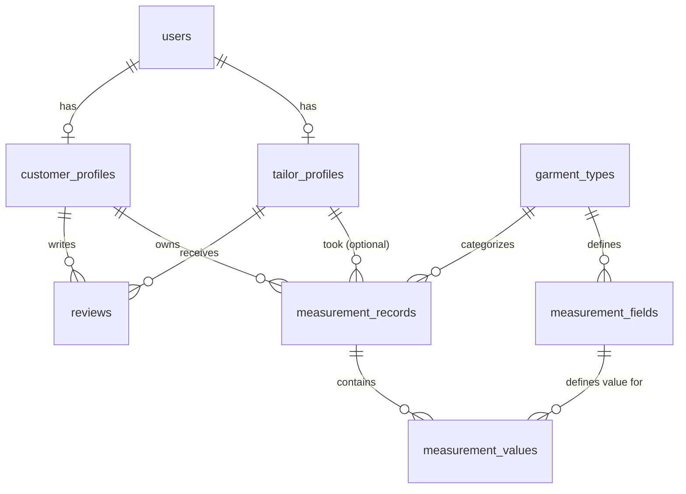

# Tailor Management Platform — Concept Overview

_Last updated: 2026-07-02_

## Vision

A platform that helps tailors manage their craft digitally — measurements,
evaluation, and business presence — while connecting tailors, customers, and
suppliers through a social/discovery layer.

## Users

- **Tailors** — manage their business, measurements, and portfolio
- **Customers** — get measured, discover tailors, place orders
- **Suppliers** — list and sell materials (fabric, thread, tools, etc.)

## Core Features

### 1. Measurement Management
- Digital customer measurement records (chest, waist, inseam, etc.), tied to
  each customer profile and reusable across future orders
- Built-in measurement guide/tutorial for accurate measurement-taking

### 2. Evaluation
- Customer ratings/reviews on completed work
- System-generated skill assessment based on job history and accuracy

### 3. Social & Discovery Layer
- Follow system between accounts
- Friend/connection suggestions
- Ranking based on follower count
- Serves three purposes:
  - **Customer discovery** — find and follow top tailors, view portfolios
  - **Tailor networking** — tailors follow each other to learn, collaborate,
    or subcontract overflow work
  - **Supplier connections** — tailors follow suppliers for stock/deal
    notifications

### 4. Supplier Marketplace
- Suppliers list materials (fabric, buttons, thread, tools) for sale
- Tailors/customers can browse and order materials directly in-app
- Full in-app marketplace (not just a directory)

### 5. Payments
- Flexible: in-app payment gateway available, offline payment also supported

### 6. Platform
- Web app + mobile app (responsive web and mobile clients)

## Phasing

### Phase 1 — MVP
- Tailor profiles
- Customer measurement records
- Measurement guide/tutorial
- Ratings/reviews

### Phase 2
- Follow system, friend suggestions, follower-based ranking
- System-generated skill assessment
- Basic order/job tracking

### Phase 3
- Supplier marketplace (listing + in-app purchase of materials)
- In-app payment gateway
- Full order-to-delivery workflow (quote → cutting → sewing → fitting →
  delivery)

## Open Questions (for later decisions)

- Ranking algorithm details (pure follower count vs. weighted by ratings,
  completed jobs, etc.)
- Detailed order/job workflow and status stages
- Payment gateway/provider choice
- Whether instrument/tool inventory tracking gets added back in a later phase
  (dropped from MVP scope)

## Progress Notes

### Phase 1 Data Model (draft — 2026-07-02, revisit later)

Decisions made: relational (SQL) database, measurement fields predefined per
garment type (not freeform).

**Entities**

- `users` — base account (id, email, phone, password_hash, full_name,
  role[tailor|customer], avatar_url, timestamps)
- `tailor_profiles` — extends users (user_id FK unique, business_name, bio,
  location, years_experience, avg_rating, rating_count, timestamps)
- `customer_profiles` — extends users (user_id FK unique, preferred_unit,
  timestamps)
- `garment_types` — reference table (id, name, description)
- `measurement_fields` — predefined fields per garment type, also holds guide
  content (id, garment_type_id FK, field_key, field_label, display_order,
  guide_instructions, guide_image_url)
- `measurement_records` — one per measuring session (id, customer_id FK,
  tailor_id FK nullable, garment_type_id FK, label, unit, notes, timestamps)
- `measurement_values` — data points for a record (id, measurement_record_id
  FK, measurement_field_id FK, value) — unique on
  (measurement_record_id, measurement_field_id)
- `reviews` — customer ratings of tailors (id, customer_id FK, tailor_id FK,
  rating[1-5], comment, created_at)

**Relationships**



**Judgment calls made (open to revisit)**

- `avg_rating`/`rating_count` denormalized on `tailor_profiles` for fast
  display, recalculated on each new review.
- No unique constraint limiting one review per customer-tailor pair, since
  Phase 1 has no order/job entity to tie a review to yet — revisit once order
  workflow lands in Phase 3.

Status: **not finalized** — parked to continue later.

### Tech Stack (draft — 2026-07-02, revisit later)

Decisions made: JS/TS across the board, cross-platform mobile, managed cloud
hosting.

| Layer | Choice | Why |
|---|---|---|
| Database | PostgreSQL (via Supabase) | Matches the relational data model already drafted; auto-generated REST/GraphQL API |
| Backend/API | Supabase (Auth, Storage, Row-Level Security, Edge Functions) | Cuts most CRUD/auth boilerplate; Edge Functions handle custom logic like ranking, review aggregation |
| Web frontend | Next.js (React + TypeScript) + Tailwind CSS | Standard, well-documented, SSR good for tailor profile SEO |
| Mobile | React Native + Expo | Single codebase for iOS/Android, shares TS types/logic with web |
| Auth | Supabase Auth | Email/phone + social login, works across web + mobile |
| File storage | Supabase Storage | Portfolio images, measurement guide images |
| Data fetching/state | TanStack Query (React Query) | Consistent caching/sync across web + mobile |
| Hosting | Vercel (web) + Supabase (DB/backend) + EAS (mobile builds) | All managed, minimal ops overhead |
| Monorepo | Turborepo | Share types, API client, business logic between web + mobile |

Trade-off flagged: Supabase Row-Level Security has a learning curve for rules
like "only the assigned tailor or the customer can see a measurement record"
— budget learning time.

Status: **not finalized** — parked to continue later.

### API Endpoints (draft — 2026-07-02, revisit later)

Since the stack uses Supabase, most simple CRUD is auto-generated via
PostgREST + RLS policies rather than hand-written. Endpoints below define the
contract; notes flag what needs custom logic (Edge Function/trigger) vs.
plain table access.

**Auth** (Supabase Auth, built-in)
- `POST /auth/signup` — email/phone + password, sets `role`
- `POST /auth/login`
- `POST /auth/logout`
- `POST /auth/password-reset`

**Profiles**
- `GET /users/me` (self) — current user + role
- `PATCH /users/me` (self) — update name, avatar, phone
- `GET /tailors` (public) — list/search, filter by location, min rating, name
- `GET /tailors/:id` (public) — profile + avg_rating
- `PATCH /tailors/me` (tailor) — update business_name, bio, location, years_experience
- `GET /customers/me` (customer)
- `PATCH /customers/me` (customer) — update preferred_unit

**Garment Types & Measurement Guide** (static reference data)
- `GET /garment-types` (public)
- `GET /garment-types/:id/fields` (public) — fields + guide instructions/images

**Measurement Records**
- `GET /measurement-records` (customer or tailor) — customer sees own; tailor sees records they took
- `POST /measurement-records` (customer or tailor) — body: garment_type_id, customer_id, tailor_id?, label, unit, values[]
- `GET /measurement-records/:id` (owner or tailor-on-record) — includes joined values
- `PATCH /measurement-records/:id` (owner or tailor-on-record)
- `DELETE /measurement-records/:id` (owner or tailor-on-record)
- `GET /customers/:id/measurement-records` (linked tailor or self)

**Reviews**
- `GET /tailors/:id/reviews` (public) — paginated
- `POST /tailors/:id/reviews` (customer) — {rating, comment} → Edge
  Function/trigger recalculates avg_rating/rating_count on tailor_profiles
- `PATCH /reviews/:id` (review owner) — triggers recalc
- `DELETE /reviews/:id` (review owner) — triggers recalc

Implementation notes:
- Everything except review writes can likely be plain Supabase table access +
  RLS policies, no custom endpoint code.
- Review create/update/delete need a Postgres trigger (preferred, atomic
  with the write) or Edge Function to keep avg_rating/rating_count in sync.
- Access control (e.g. "tailor can only see measurement records they took")
  enforced via RLS policies, not application code.

Status: **not finalized** — parked to continue later.

### Phase 2: Follow & Ranking System (draft — 2026-07-02, revisit later)

Decisions made: pure follower count for ranking, scoped leaderboards
(location + specialty), suggestions based on mutual connections + location +
specialty match + trending.

**Data model additions**

- `follows` — generic user-to-user (id, follower_id FK→users, followee_id
  FK→users, created_at). Unique(follower_id, followee_id), check follower_id
  ≠ followee_id. Judgment call: single generic table (not per pair type) so
  it transparently supports tailor→supplier follows once Phase 3 adds
  supplier profiles, no schema change needed.
- `tailor_specialties` (new, not in Phase 1 model) — many-to-many (id,
  tailor_id FK→tailor_profiles, garment_type_id FK→garment_types), needed for
  specialty-scoped ranking/suggestions.
- `tailor_profiles.follower_count` (int, default 0) — denormalized, kept in
  sync via trigger on `follows` insert/delete (only when followee is a
  tailor).

**Ranking**

- Formula: pure follower count (`ORDER BY follower_count DESC`)
- Scope: filtered leaderboards by location and/or specialty (via
  `tailor_specialties`), e.g. "Top tailors in Lagos" or "Top wedding-wear
  tailors." Global leaderboard = unfiltered case of the same query.
- Straight indexed query on `follower_count`, no materialized view needed yet.

**Follow suggestions** — composite score:

```
suggestion_score =
    (mutual_connections_count × 3)   -- accounts followed by people you follow
  + (location_match ? 2 : 0)         -- same city/location
  + (specialty_match_count × 2)      -- specialty overlap (tailor<->tailor,
                                          or tailor specialty vs customer's
                                          measurement garment types)
  + (trending_score × 1)             -- follower growth rate, trailing 7 days
```

Weights are a starting guess, not tuned — revisit once there's real usage
data.

**API endpoints (Phase 2)**

- `POST /follows` — {followee_id}, triggers follower_count update
- `DELETE /follows/:followee_id` — unfollow
- `GET /users/:id/followers` — paginated
- `GET /users/:id/following` — paginated
- `GET /rankings/tailors` — query params: location?, specialty? — leaderboard
- `GET /suggestions/follows` — personalized, for authenticated user

Status: **not finalized** — parked to continue later.

### Phase 3: Supplier Marketplace (draft — 2026-07-02, revisit later)

Decisions made: products have variants (color/unit of sale), supplier
handles their own fulfillment (no shipping integration), commission/fee
model deferred.

**Data model additions**

- `supplier_profiles` — extends users for role='supplier', mirrors
  `tailor_profiles` (id, user_id FK unique, business_name, bio, location,
  follower_count, timestamps). Reuses Phase 2's generic `follows` table;
  follower_count trigger extended to cover supplier followees too.
- `product_categories` — reference table (id, name unique) — Fabric,
  Buttons, Thread, Tools, etc.
- `products` (id, supplier_id FK→supplier_profiles, category_id
  FK→product_categories, name, description, images[], timestamps)
- `product_variants` — since materials are sold in different colors/units
  (id, product_id FK→products, variant_name, unit_type[yard|meter|piece|kg],
  price, stock_quantity[decimal, supports fractional], sku)
- `orders` — marketplace purchase orders, distinct from tailor job/work
  orders which are still out of scope (id, buyer_id FK→users, supplier_id
  FK→supplier_profiles, status[pending|confirmed|ready|completed|cancelled],
  fulfillment_type[supplier_shipping|local_pickup],
  payment_method[in_app|offline], payment_status[pending|paid|failed],
  total_amount, timestamps)
- `order_items` (id, order_id FK→orders, product_variant_id
  FK→product_variants, quantity, unit_price_at_purchase [snapshot, protects
  against later price changes], subtotal)

Judgment call: no `carts` table for now — cart is client-side state until
checkout creates the order.

**API endpoints (Phase 3)**

- `GET /suppliers` / `GET /suppliers/:id` / `PATCH /suppliers/me`
- `GET /products` (search/filter by category, supplier, price range) /
  `GET /products/:id` / `POST /products` (supplier) / `PATCH /products/:id` /
  `DELETE /products/:id`
- `POST /products/:id/variants` / `PATCH /product-variants/:id` /
  `DELETE /product-variants/:id`
- `POST /orders` (buyer) — {supplier_id, items:[{variant_id, quantity}],
  payment_method, fulfillment_type}
- `GET /orders` (scoped to buyer's own, or supplier's received) /
  `GET /orders/:id`
- `PATCH /orders/:id/status` (supplier, advance status) /
  `PATCH /orders/:id/cancel` (buyer, only while pending)

**Open questions (deliberately unresolved)**

- Commission/fee model — deferred; schema can add `platform_fee_amount` to
  `orders` later without breaking anything
- Whether suppliers/products get reviews too (Phase 1 `reviews` table is
  currently tailor-only) — decide before Phase 3 build starts
- Stock decrement timing — on order creation vs. on order confirmation
  (affects overselling risk)

Status: **not finalized** — parked to continue later.

### Phase 2: Skill Assessment System (draft — 2026-07-02, revisit later)

Decisions made: job tracking includes timeline (due_date/completed_at),
accuracy measured via customer fit-confirmation (no physical verification
possible), output is both a numeric score and a derived tier/badge.

**Prerequisite: `jobs` table** (basic order/job tracking, not previously
defined — needed as the data source for skill signals)

- id, measurement_record_id FK→measurement_records, tailor_id
  FK→tailor_profiles, status[in_progress|completed|cancelled], due_date,
  completed_at (on-time if completed_at <= due_date), fit_confirmation
  [yes|somewhat|no, nullable until customer responds], timestamps

**Skill score formula**

```
skill_score (0-100) =
    (min(completion_count, 100) / 100 × 30)   -- experience, capped so it plateaus
  + (on_time_rate × 25)                        -- % completed by due_date
  + (avg_rating / 5 × 25)                      -- from Phase 1 reviews
  + (fit_confirmation_rate × 20)                -- % of "yes" among responded jobs
```

Weights are a starting guess, not tuned — revisit once there's real usage
data (same caveat as the Phase 2 ranking weights).

**Tiers**

| Score | Tier |
|---|---|
| 0-39 | Beginner |
| 40-69 | Skilled |
| 70-89 | Expert |
| 90-100 | Master |

**`tailor_profiles` additions**: `skill_score` (decimal, denormalized),
`skill_tier` (enum, denormalized)

Judgment call: recompute via a scheduled job (e.g. nightly Edge Function),
not a synchronous trigger — the formula pulls from both `jobs` and
`reviews`, so a single-table trigger can't cleanly cover every input change.
Up to 24h delay in score updates is an acceptable tradeoff for simplicity.

**API endpoints**

- `POST /jobs` (tailor) — accept work on a measurement_record, set due_date
- `PATCH /jobs/:id/status` (tailor) — in_progress → completed
- `PATCH /jobs/:id/fit-confirmation` (customer) — {fit_confirmation}, post-delivery
- `GET /tailors/:id/skill` (public) — returns skill_score + skill_tier

Status: **not finalized** — parked to continue later.

### Order/Job Workflow, detailed (draft — 2026-07-02, revisit later)

Decisions made: pricing supports both standard (fixed per garment type) and
custom quotes, broad status stages (not sub-split into cutting/sewing),
fitting supports an iteration loop (fitting → adjustments → re-fitting).

**State machine**

```
requested --accept--> accepted --start--> in_progress --> ready_for_fitting
    |                                                          |    ^
    +--reject--> rejected                              fits? --+    |
                                                          |          |
                                                         yes        no
                                                          |          |
                                                          v          v
                                                      completed  adjusting
                                                          |      (loops back
                                                          v       to ready_for_fitting
                                                      delivered   when tailor's done)

(cancelled reachable from requested/accepted/in_progress)
```

**`jobs` table — extended from the Phase 2 version**

- id, measurement_record_id FK→measurement_records (Phase 2), tailor_id
  FK→tailor_profiles (Phase 2), garment_type_id FK→garment_types (new, for
  standard price lookup), status[requested|accepted|rejected|in_progress|
  ready_for_fitting|adjusting|completed|delivered|cancelled] (expanded from
  Phase 2's 3-state version), price (set at acceptance),
  price_type[standard|custom], payment_status[pending|paid],
  payment_method[in_app|offline] (reuses Phase 1's flexible payment
  decision), fitting_iteration_count (int, default 0, increments each
  ready_for_fitting→adjusting loop), due_date, completed_at,
  fit_confirmation[yes|somewhat|no] (Phase 2 field, now also drives the
  fitting loop transition), timestamps

**New: `tailor_service_prices`** — standard/fixed pricing (id, tailor_id
FK→tailor_profiles, garment_type_id FK→garment_types, price). Unique(tailor_id,
garment_type_id). A request auto-suggests this price; tailor can override
with a custom quote at acceptance.

**New: `job_status_history`** — audit log (id, job_id FK→jobs, from_status,
to_status, changed_by FK→users, note, created_at). Needed because of the
fitting loop — without this you can't tell how many adjustment rounds
happened or when, which also feeds the skill-assessment on-time signal.

**API endpoints**

- `POST /jobs` (customer) — {measurement_record_id, tailor_id,
  garment_type_id, notes}, auto-suggests standard price if one exists
- `PATCH /jobs/:id/accept` (tailor) — {price?, due_date}, price required
  only if no standard rate or overriding it
- `PATCH /jobs/:id/reject` (tailor) — {reason}
- `PATCH /jobs/:id/status` (tailor) — advances accepted→in_progress→
  ready_for_fitting, validated against allowed transitions only
- `PATCH /jobs/:id/fitting-outcome` (customer or tailor) — {fit_confirmation}
  → auto-transitions to completed (yes) or adjusting (somewhat/no),
  increments fitting_iteration_count
- `PATCH /jobs/:id/status` (delivered, tailor) — completed → delivered
- `PATCH /jobs/:id/cancel` (either party) — only before in_progress
- `GET /jobs/:id/history` (job participants) — status change log
- `GET /jobs` (scoped) — customer sees own, tailor sees theirs
- `GET/POST/PATCH /tailors/me/service-prices` (tailor) — manage standard
  pricing per garment type

**Open questions**

- Deposit vs. full payment timing — currently a single payment_status,
  doesn't yet support partial/deposit payments
- Who can trigger ready_for_fitting → in_progress after adjustments — tailor
  only, or does customer need to confirm they're ready to be fitted again?
- Cap on fitting_iteration_count — unlimited loops could stall a job
  indefinitely; worth a soft limit or escalation path

Status: **not finalized** — parked to continue later.
